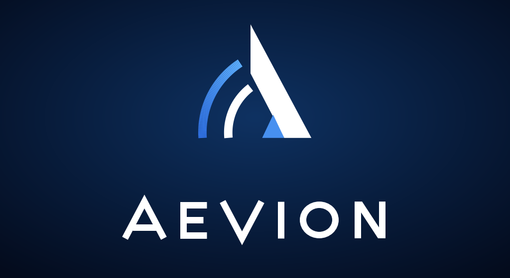

# Aevion

A NISAR-powered Earth change twin. Built for NASA Space Apps 2026: Dancing with the SARs.

**Built by** Rui Sun, Aaryaman Chopra, Palash Desarda, Andrew Chen, Ethan de Guzman and Kaiyaan Faisal.

Live: https://tryaevion.vercel.app
